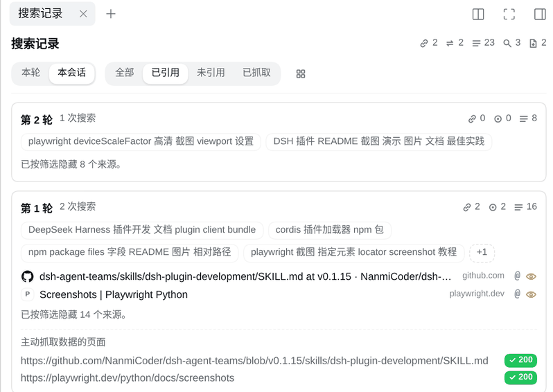
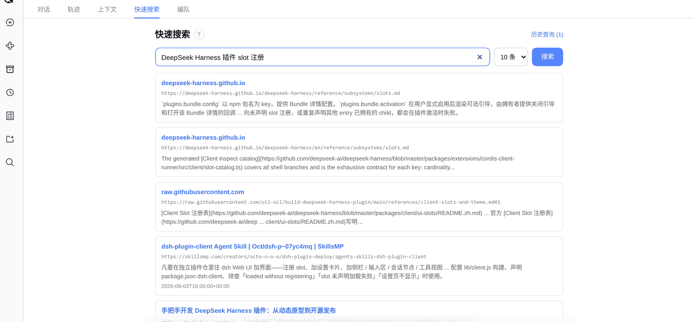
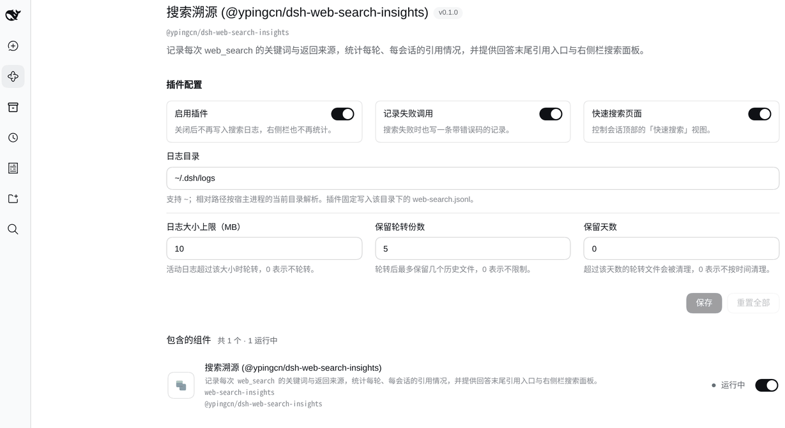

# dsh-web-search-insights

DeepSeek Harness（DSH）插件：把 Agent 的 `web_search` 使用情况做成「可审计的日志 + 可回看的引用统计」。

- **审计日志**：每次 `web_search` 的关键词与结果网址 + 标题写入 JSONL，失败调用可选记录错误码；
- **会话统计**：`webSearchInsights` 投影产出本轮/本会话的引用来源、返回来源，以及被 `web_fetch` 抓取过的页面；
- **界面**：每条回答末尾的引用入口、右侧栏「搜索记录」面板（本轮/本会话、按已引用/未引用/已抓取筛选、按域名分组），以及会话顶部的「快速搜索」视图。

## 效果展示

 - 每条回答末尾的引用入口：来源图标 + 本轮/会话引用数 + 查看按钮


 - 按已引用筛选后的来源列表


 - 快速搜索视图与结果列表


## 依赖要求

- DSH `>=0.2.1-rc.2 <0.3.0`；
- Node.js `^22.19.0 || >=24.0.0`；
- 快速搜索依赖宿主提供同源 HTTP 路由（web profile 自带）。

## 安装

### 方式 A：从 npm 安装（推荐）

```bash
dsh plugin --profile web add @ypingcn/dsh-web-search-insights
```

### 方式 B：从 GitHub 安装

```bash
dsh plugin --profile web add github:ypingcn/dsh-web-search-insights
```

### 方式 C：本地 link 安装（开发调试）

```bash
dsh plugin --profile web add link:/path/to/dsh-web-search-insights
```

## 配置项

插件管理页打开「搜索溯源」后，详情页里会直接出现配置表单。


